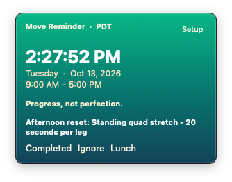
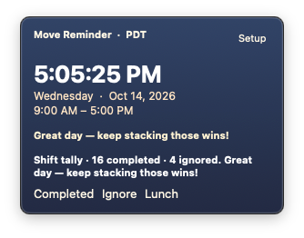

# Move Reminder

An always-on-top 4 × 3 inch floating panel for macOS that prompts you to move
every 20 or 30 minutes during your workday.  No menu-bar icon, no Dock icon —
just a quiet, draggable strip that stays out of the way until it's time to move.

Built with **Swift + SwiftUI + AppKit**.  Requires macOS 13 Ventura or later.

---

## Features

- Live clock with timezone label
- Morning and afternoon exercise prompt rotations (shuffled per day)
- Morning and afternoon motivational quotes (shuffled per day)
- Gradient background that changes colour with each interval
- Completed / Ignore / Lunch tracking — daily stats saved to disk
- Configurable shift start/end (6 AM – 11 AM start, 1 PM – 8 PM end)
- 20 or 30 minute reminder interval
- Auto-hides after each action; auto-reappears at the next interval
- Draggable from any non-button area
- No Dock icon, no menu-bar icon (`LSUIElement`)
- Prefs and stats stored in `~/Library/Application Support/MoveReminder/`

---

## Screenshots





---

## Building

### Option A — Xcode (recommended)

1. Open `MoveReminder.xcodeproj` in Xcode 15 or later.
2. Select the **MoveReminder** scheme.
3. Press **⌘R** to run, or **Product → Archive** to produce a distributable `.app`.

If Xcode asks about signing, choose **Automatically manage signing** and pick
your personal team (a free Apple ID works for local use).

### Option B — command line

```bash
chmod +x build.sh
./build.sh
```

The built app lands at `build/Build/Products/Release/Move Reminder.app`.
Drag it to `/Applications`, then **right-click → Open** on first launch to
bypass Gatekeeper.

---

## Keyboard shortcuts

| Key | Action |
|-----|--------|
| Escape | Ignore current prompt |
| ⌘W / ⌘H | Ignore current prompt |
| ⌘Q | Quit |

---

## File layout

```
MoveReminder-Mac/
├── MoveReminder.xcodeproj/
│   ├── project.pbxproj
│   └── xcshareddata/xcschemes/MoveReminder.xcscheme
├── MoveReminder/
│   ├── MoveReminderApp.swift   — @main entry point + AppDelegate
│   ├── FloatingPanel.swift     — borderless always-on-top NSPanel
│   ├── AppViewModel.swift      — all state, timer, and action logic
│   ├── Content.swift           — exercise / motivation strings & palettes
│   ├── Models.swift            — Prefs, Stats (Codable) + utility functions
│   ├── MainView.swift          — main SwiftUI panel + Color(hex:) extension
│   ├── SettingsView.swift      — shift-setup SwiftUI panel
│   └── Info.plist
├── build.sh
├── CHANGELOG.md
└── README.md
```

---

## Data files

| File | Contents |
|------|----------|
| `~/Library/Application Support/MoveReminder/prefs.json` | Shift hours and interval |
| `~/Library/Application Support/MoveReminder/stats.json` | Today's completed/ignored counts |

Both files are plain JSON and reset automatically when a new day begins.

AcknowledgementsL
Exercises and Motivational Messages contributions by Skarton <3
